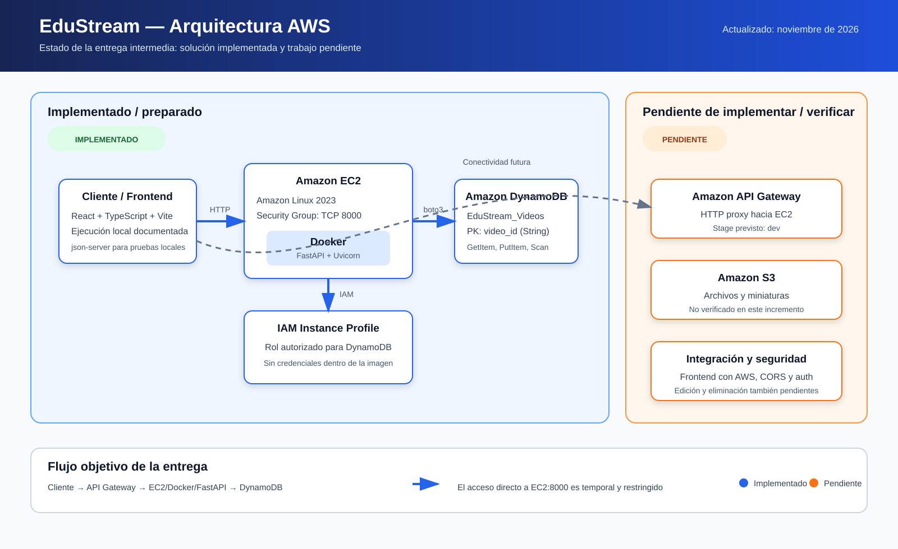
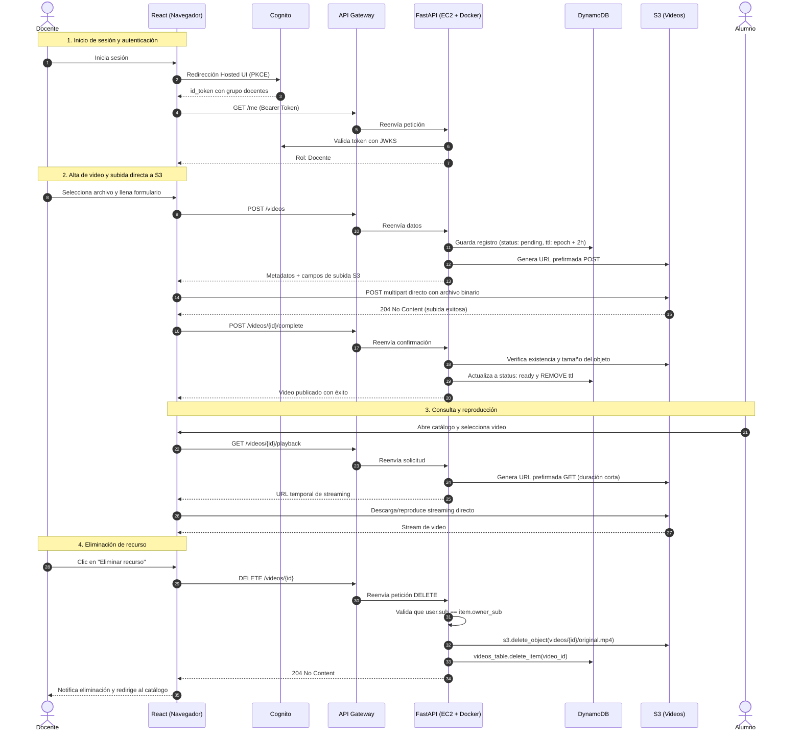

# EduStream

Plataforma académica para publicar y consultar material audiovisual organizado por materia. Los docentes suben videos y los alumnos los consultan y reproducen, con autenticación real mediante Amazon Cognito y almacenamiento en AWS.

## Integrantes

- Fabián Patricio Gaxiola Valades.
- José Ignacio Dávila Sandoval.

## Código y rama de trabajo

Los cambios más recientes están en el repositorio remoto, en la rama **`feature/actualizacion-documentacion-despliegue-aws`**:

```bash
git clone https://github.com/jdavila-sandoval/proyecto-integrador-o2026.git
cd proyecto-integrador-o2026
git checkout feature/actualizacion-documentacion-despliegue-aws
```

Actualización de este documento: 27 de noviembre de 2026.

---

## Enlaces del entorno desplegado en AWS

El proyecto se encuentra 100% desplegado en la nube de AWS (región `us-east-1`):

| Componente | URL / Identificador | Descripción |
|---|---|---|
| **Frontend Web (HTTPS)** | [https://4q76jvcjwa.execute-api.us-east-1.amazonaws.com](https://4q76jvcjwa.execute-api.us-east-1.amazonaws.com) | Aplicación React alojada en S3 estático con proxy HTTPS en API Gateway |
| **Backend API (HTTPS)** | [https://j72eps3z3f.execute-api.us-east-1.amazonaws.com](https://j72eps3z3f.execute-api.us-east-1.amazonaws.com) | API Gateway v2 conectado con el contenedor FastAPI en EC2 |
| **Cognito Hosted UI** | [https://edustream-auth-jdavila.auth.us-east-1.amazoncognito.com](https://edustream-auth-jdavila.auth.us-east-1.amazoncognito.com) | Portal de autenticación OIDC/OAuth 2.0 PKCE |
| **User Pool ID** | `us-east-1_rNhUTDMSd` | Grupo de usuarios de EduStream en Cognito |
| **App Client ID** | `6ihn9phjh33qc2b1i45mrmnptl` | Cliente web público (sin secret) |
| **Bucket Frontend** | `edustream-frontend-jdavila` | Bucket S3 para archivos estáticos del frontend |
| **Bucket Videos** | `edustream-videos-storage-jdavila` | Bucket S3 privado para almacenamiento de archivos de video |

### Usuarios de prueba preconfigurados

| Rol | Correo / Usuario | Contraseña | Grupo Cognito |
|---|---|---|---|
| **Docente** | `docente@iteso.mx` | `Password123!` | `docentes` |
| **Alumno** | `alumno@iteso.mx` | `Password123!` | `alumnos` |

---

## Estado actual

El flujo principal funciona de extremo a extremo, probado tanto con `curl` como desde la interfaz React desplegada en la nube: inicio de sesión, roles, catálogo, materias, alta con subida directa a S3, reproducción, eliminación de recursos y limpieza automática con TTL.

| Componente | Estado | Detalle |
|---|---|---|
| **Frontend React + TypeScript + Vite** | Funcional en la nube | Desplegado en S3 estático (`edustream-frontend-jdavila`) con proxy HTTPS API Gateway. Compatible también en local con `npm run dev`. |
| **Autenticación con Cognito (Hosted UI, OIDC)** | Funcional | Flujo Authorization Code con PKCE. Tokens JWT validados en frontend y backend. |
| **Autorización por grupo (`docentes`, `alumnos`)** | Funcional | Guardias de rol en rutas del frontend (`CurrentUserContext`) y dependencias de seguridad en FastAPI (`require_group`). |
| **Backend FastAPI en Docker sobre EC2** | Funcional | Ejecutándose en instancia `t3.micro` con Docker. CORS dinámico vía variable de entorno. |
| **API Gateway v2 (HTTP API)** | Funcional | Enrutamiento transparente HTTPS tanto para backend como para frontend. |
| **DynamoDB: `EduStream_Videos`** | Funcional | Almacena metadatos. Cuenta con **TTL activado** (`ttl`) para eliminar automáticamente registros huérfanos tras 2 horas. |
| **DynamoDB: `EduStream_Subjects`** | Funcional | Catálogo de materias activas (`SUB-NUBE`, `SUB-CLIENTE`, `SUB-ARQ`). |
| **Bucket S3 privado (`edustream-videos-storage-jdavila`)** | Funcional | Almacenamiento seguro. Reglas de CORS habilitadas para carga multipart directa desde el navegador. |
| **Subida de video (POST prefirmado)** | Funcional | Carga directa desde el cliente a S3 sin saturar el backend. Barra de progreso en tiempo real. |
| **Confirmación de subida** | Funcional | Endpoint `POST /videos/{id}/complete` que verifica el objeto en S3, pasa estado a `ready` y remueve el TTL. |
| **Reproducción de video (GET prefirmado)** | Funcional | Endpoint `GET /videos/{id}/playback` genera URL temporal de lectura en S3. |
| **Eliminación de video (`DELETE /videos/{id}`)** | Funcional | Botón disponible para Docentes. Valida propiedad del recurso (`owner_sub`), elimina el archivo de S3 y el ítem de DynamoDB. |
| **Script de resiliencia y recuperación** | Funcional | Automatiza la sincronización de IP de EC2 y API Gateway tras reinicios en AWS Learner Lab (`scripts/actualizar-entorno.ps1` y `.sh`). |

---

### Matriz de permisos por rol

| Acción | Alumno | Docente |
|---|:---:|:---:|
| Iniciar sesión mediante Cognito | ✅ | ✅ |
| Consultar catálogo de videos publicados | ✅ | ✅ |
| Filtrar videos por materia o búsqueda | ✅ | ✅ |
| Ver detalle y reproducir videos (`ready`) | ✅ | ✅ |
| Publicar nuevo video (metadatos + archivo en S3) | ❌ | ✅ |
| Eliminar recursos propios (S3 + DynamoDB) | ❌ | ✅ |

---

### Endpoints del backend

| Método y ruta | Acceso | Descripción |
|---|---|---|
| `GET /health` | Público | Comprobación de estado y conectividad del servicio |
| `GET /me` | Usuario autenticado | Información del usuario autenticado y rol asignado |
| `GET /subjects` | Usuario autenticado | Catálogo de materias disponibles |
| `GET /videos` | Usuario autenticado | Catálogo de videos completados (`status: ready`) |
| `GET /videos/{video_id}` | Usuario autenticado | Detalle y metadatos de un video específico |
| `POST /videos` | Grupo `docentes` | Crea registro (`status: pending`) con TTL de 2h y genera URL prefirmada POST para S3 |
| `POST /videos/{video_id}/complete` | Grupo `docentes` | Verifica el archivo en S3, actualiza estado a `ready` y elimina el atributo TTL |
| `GET /videos/{video_id}/playback` | Usuario autenticado | Genera URL prefirmada GET temporal para reproducción directa |
| `DELETE /videos/{video_id}` | Grupo `docentes` (autor) | Valida que `owner_sub` coincida con el usuario, borra el archivo en S3 y el registro en DynamoDB |

---

## Arquitectura

El siguiente diagrama muestra la arquitectura integral implementada en Amazon Web Services:



> La definición formal de la arquitectura se encuentra en [`docs/arquitectura-aws.yaml`](docs/arquitectura-aws.yaml).

### Servicios y responsabilidades

| Servicio | Función en EduStream |
|---|---|
| **Amazon Cognito** | Directorio de usuarios, autenticación OIDC/OAuth2 con Hosted UI, emisión de `id_token` y asignación de grupos (`docentes`, `alumnos`). |
| **Amazon S3 (Frontend)** | Bucket `edustream-frontend-jdavila` configurado como Static Website Hosting para alojar la SPA (Single Page Application). |
| **Amazon API Gateway (Frontend)** | API HTTP `edustream-frontend` (`4q76jvcjwa`) que actúa como proxy inverso HTTPS hacia el bucket S3 estático. |
| **Amazon API Gateway (Backend)** | API HTTP `edustream-backend-api` (`j72eps3z3f`) que expone el backend con HTTPS y redirige el tráfico hacia el puerto 8000 de EC2. |
| **Amazon EC2 + Docker** | Instancia Amazon Linux 2023 con contenedor Docker corriendo FastAPI + Uvicorn. Ejecuta la lógica de negocio y validación de tokens. |
| **Security Groups** | Reglas de firewall de red. El script de resiliencia mantiene abierto el puerto TCP 8000 para el tráfico de la API. |
| **AWS IAM (`LabRole`)** | Perfil de instancia que proporciona credenciales efímeras y seguras a la aplicación sin necesidad de almacenar llaves estáticas. |
| **Amazon DynamoDB** | Base de datos NoSQL con las tablas `EduStream_Videos` (con TTL) y `EduStream_Subjects`. |
| **Amazon S3 (Videos)** | Bucket privado `edustream-videos-storage-jdavila` con reglas CORS para carga directa multipart y streaming seguro vía URLs prefirmadas. |

---

## Flujo de subida, reproducción y eliminación



---

## Cómo ejecutar y desplegar

### 1. Variables de entorno del Frontend (`.env`)

Crea un archivo `.env` en la raíz del proyecto para desarrollo local o para compilar el frontend hacia producción:

```env
VITE_COGNITO_AUTHORITY=https://cognito-idp.us-east-1.amazonaws.com/us-east-1_rNhUTDMSd
VITE_COGNITO_CLIENT_ID=6ihn9phjh33qc2b1i45mrmnptl
VITE_COGNITO_REDIRECT_URI=https://4q76jvcjwa.execute-api.us-east-1.amazonaws.com/auth/callback
VITE_COGNITO_LOGOUT_URI=https://4q76jvcjwa.execute-api.us-east-1.amazonaws.com
VITE_COGNITO_DOMAIN=https://edustream-auth-jdavila.auth.us-east-1.amazoncognito.com
VITE_API_URL=https://j72eps3z3f.execute-api.us-east-1.amazonaws.com
```

> **Nota:** Para ejecutar localmente, cambia `VITE_COGNITO_REDIRECT_URI` a `http://localhost:5173/auth/callback` y `VITE_COGNITO_LOGOUT_URI` a `http://localhost:5173`. Ambas URLs ya están registradas en el App Client de Cognito.

### 2. Despliegue del Frontend a AWS S3

```bash
# Instalar dependencias y compilar
npm install
npm run build

# Sincronizar archivos estáticos con el bucket S3
aws s3 sync dist/ s3://edustream-frontend-jdavila/ --delete
```

### 3. Despliegue del Backend en EC2 (Docker)

Conéctate a la instancia EC2 por SSH:

```bash
ssh -i "edustream-key.pem" ec2-user@<IP_PUBLICA_EC2>
```

Dentro de la instancia, construye y ejecuta el contenedor con todas sus variables de entorno:

```bash
cd proyecto-integrador-o2026/src/backend
git pull
sudo docker build -t edustream-api .

# Detener contenedor previo si existe
sudo docker stop edustream-backend 2>/dev/null || true
sudo docker rm edustream-backend 2>/dev/null || true

# Ejecutar el contenedor
sudo docker run -d \
  --name edustream-backend \
  --restart unless-stopped \
  -p 8000:8000 \
  -e AWS_DEFAULT_REGION=us-east-1 \
  -e DYNAMODB_TABLE=EduStream_Videos \
  -e SUBJECTS_TABLE=EduStream_Subjects \
  -e VIDEOS_BUCKET=edustream-videos-storage-jdavila \
  -e MAX_UPLOAD_BYTES=524288000 \
  -e COGNITO_REGION=us-east-1 \
  -e COGNITO_USER_POOL_ID=us-east-1_rNhUTDMSd \
  -e COGNITO_CLIENT_ID=6ihn9phjh33qc2b1i45mrmnptl \
  -e CORS_ORIGINS='*' \
  edustream-api
```

Verificar estado en EC2:
```bash
curl http://localhost:8000/health
```

---

## Scripts de resiliencia (AWS Learner Lab)

Dado que en AWS Learner Lab las instancias EC2 cambian de dirección IP pública al apagarse o reiniciarse tras terminar la sesión de 4 horas, se incluyeron scripts automatizados de resiliencia:

- **PowerShell (Windows):** `scripts/actualizar-entorno.ps1`
- **Bash (Linux / macOS):** `scripts/actualizar-entorno.sh`

### Qué hace el script automáticamente:

1. Valida las credenciales de AWS activas (`aws sts get-caller-identity`).
2. Obtiene la IP pública actual de la instancia EC2 (`i-0da66503c5157fdcd`) e inicia la instancia si está detenida.
3. Actualiza el Security Group (`sg-0108695f0d2701501`) para permitir la entrada en el puerto 8000.
4. Actualiza la integración HTTP de API Gateway (`j72eps3z3f` / integración `8m5f8ar`) para apuntar a la nueva IP de EC2 (`http://<NUEVA_IP>:8000`).
5. Realiza un health check a través de la URL pública de API Gateway para confirmar la recuperación.

**Uso:**
```powershell
.\scripts\actualizar-entorno.ps1
```

---

## Pruebas rápidas con `curl`

```bash
API="https://j72eps3z3f.execute-api.us-east-1.amazonaws.com"

# Comprobación pública de vida
curl -s "$API/health"

# Consultar catálogo de materias con token
TOKEN="<id_token_cognito>"
curl -s "$API/subjects" -H "Authorization: Bearer $TOKEN"

# Consultar videos
curl -s "$API/videos" -H "Authorization: Bearer $TOKEN"
```

---

## Pendientes y trabajo futuro

- **Edición de metadatos (`PATCH /videos/{id}`)**: Permitir actualizar título, materia, unidad y descripción de videos existentes.
- **Consulta por materia mediante índice GSI (`SubjectIndex`)**: Optimizar consultas por materia en lugar de filtrar tras un Scan.
- **Restricción estricta de visibilidad**: Filtrar videos con visibilidad `group` para que solo sean accesibles por los alumnos inscritos en dicho grupo.
- **Transcodificación y generación de miniaturas**: Integrar AWS Lambda o MediaConvert para generar resoluciones adaptativas y miniaturas automáticas al completar la subida.

---

## Documentación detallada

- [Modelo de datos y TTL](docs/modelo-datos.md)
- [Especificación completa de la API](docs/api.md)
- [Guía de despliegue y resiliencia](docs/despliegue.md)
- [Control de pendientes y roadmap](docs/pendientes.md)
