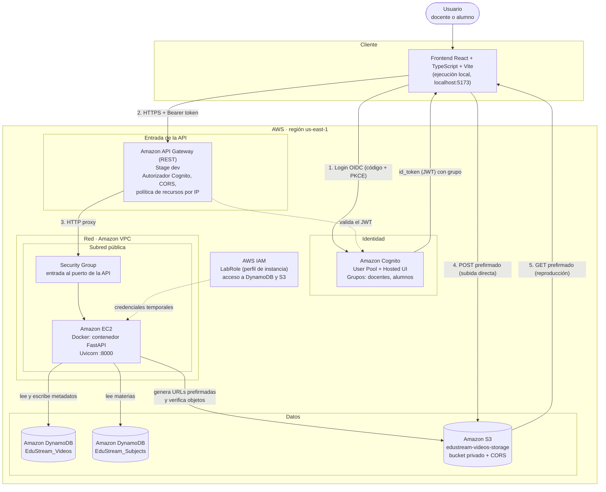
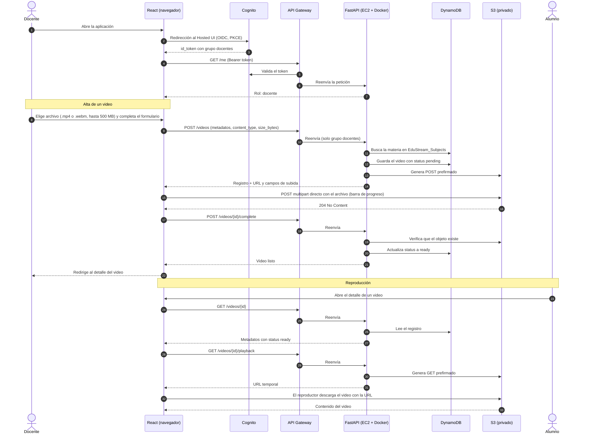

# EduStream

Plataforma académica para publicar y consultar material audiovisual organizado por materia. Los docentes suben videos y los alumnos los consultan y reproducen, con autenticación real y almacenamiento en AWS.

## Integrantes

- Fabián Patricio Gaxiola Valades.
- José Ignacio Dávila Sandoval.

## Código y rama de trabajo

Los cambios más recientes están en el repositorio remoto, en la rama **`feat/conectar-front-back`**:

```bash
git clone https://github.com/jdavila-sandoval/proyecto-integrador-o2026.git
cd proyecto-integrador-o2026
git checkout feat/conectar-front-back
```

Actualización de este documento: 26 de noviembre de 2026.

## Estado actual

El flujo principal funciona de extremo a extremo, probado con `curl` y desde la interfaz React: inicio de sesión, roles, catálogo, alta con archivo real, subida directa a S3 y reproducción.

| Componente | Estado |
|---|---|
| Frontend React, TypeScript y Vite | Funcional; se ejecuta en local con `npm run dev` |
| Autenticación con Cognito (Hosted UI, OIDC) | Funcional |
| Autorización por grupo (`docentes`, `alumnos`) | Funcional en la API y en las rutas del frontend |
| Backend FastAPI en Docker sobre EC2 | Funcional |
| API Gateway (REST, stage `dev`) con autorizador de Cognito | Funcional |
| DynamoDB: `EduStream_Videos` y `EduStream_Subjects` | Funcional |
| Bucket S3 privado `edustream-videos-storage` (`us-east-1`) | Funcional |
| Subida de video (URL POST prefirmada, directo desde el navegador) | Funcional |
| Reproducción (URL GET prefirmada de corta duración) | Funcional |
| Catálogo, detalle, panel del docente y alta | Conectados a la API real |

### Qué puede hacer cada rol

| Acción | Alumno | Docente |
|---|---|---|
| Iniciar sesión con Cognito | Sí | Sí |
| Ver catálogo y materias | Sí | Sí |
| Ver detalle y reproducir | Sí | Sí |
| Publicar video (metadatos + archivo) | No | Sí |

### Endpoints del backend

| Método y ruta | Acceso | Descripción |
|---|---|---|
| `GET /health` | Público | Comprobación de vida del servicio |
| `GET /me` | Usuario autenticado | Datos del usuario y su rol |
| `GET /subjects` | Usuario autenticado | Materias disponibles |
| `GET /videos` | Usuario autenticado | Catálogo de videos |
| `GET /videos/{video_id}` | Usuario autenticado | Detalle de un video |
| `POST /videos` | Grupo `docentes` | Crea el registro (`status: pending`) y devuelve la subida prefirmada |
| `POST /videos/{video_id}/complete` | Grupo `docentes` | Verifica el objeto en S3 y marca el video como `ready` |
| `GET /videos/{video_id}/playback` | Usuario autenticado | Devuelve una URL prefirmada para reproducir |

### Modelo de datos

- **`EduStream_Videos`**: identificador del video, título, `subject_id`, nombre y código de la materia, unidad, descripción, `visibility`, `owner_sub`, `status` (`pending` o `ready`), `object_key`, `content_type`, `size_bytes` y fecha de registro.
- **`EduStream_Subjects`**: `id`, `name` y `code` de cada materia (por ejemplo `SUB-NUBE`, "Desarrollo en la Nube", `NUBE-01`).
- **S3**: los archivos se guardan en `videos/{video_id}/original.mp4` (o la extensión que corresponda al tipo de contenido).

## Arquitectura

El siguiente diagrama muestra todos los servicios de nube utilizados, de la red al almacenamiento.



### Qué hace cada servicio

| Servicio | Función en EduStream |
|---|---|
| **Amazon Cognito** | Registra usuarios, emite el `id_token` y define el rol mediante los grupos `docentes` y `alumnos`. Provee la pantalla de inicio de sesión (Hosted UI). |
| **Amazon API Gateway** | Única puerta de entrada pública de la API. Valida el token con el autorizador de Cognito, aplica CORS y restringe orígenes por IP con una política de recursos. Reenvía las peticiones al backend con integración HTTP proxy. |
| **Amazon VPC** | Red privada lógica donde vive la instancia. Define la subred y el enrutamiento. |
| **Security Group** | Cortafuegos de la instancia: solo permite el tráfico necesario hacia el puerto de la API (y SSH para administración). |
| **Amazon EC2 + Docker** | Ejecuta el contenedor con FastAPI. Concentra la lógica de negocio y la autorización por grupo. |
| **AWS IAM (`LabRole`)** | El perfil de instancia entrega credenciales temporales al contenedor. No hay llaves incrustadas en la imagen ni en Git. |
| **Amazon DynamoDB** | Persistencia de videos y materias. |
| **Amazon S3** | Almacena los archivos de video en un bucket privado. El acceso es solo mediante URLs prefirmadas de corta duración. |

> **Pendiente de confirmar por el equipo:** el diagrama muestra la integración de API Gateway con el backend como HTTP proxy hacia la instancia EC2. Si en el despliegue se usa un VPC Link con un balanceador (NLB o ALB), o un nombre de subred o grupo de seguridad específico, actualizar esta sección con esos nombres reales.

## Flujo actual

Publicación de un video por un docente y su reproducción posterior por cualquier usuario autenticado:



Si la URL prefirmada caduca durante la sesión, el reproductor solicita una nueva una vez antes de mostrar el error.

## Cómo ejecutar

### Frontend

```bash
npm install
cp .env.example .env   # completar con los valores reales
npm run dev
```

Variables del frontend (`.env`; ninguna es secreta, pero no se versiona el archivo real):

```env
VITE_COGNITO_AUTHORITY=
VITE_COGNITO_CLIENT_ID=
VITE_COGNITO_REDIRECT_URI=
VITE_COGNITO_LOGOUT_URI=
VITE_COGNITO_DOMAIN=
VITE_API_URL=
```

`VITE_API_URL` debe apuntar al stage `dev` de API Gateway. La URI de redirección y la de cierre de sesión deben coincidir con las registradas en el cliente de aplicación de Cognito.

### Backend (Docker en EC2)

```bash
cd src/backend
docker build -t edustream-api .
docker run -d --name edustream-api --restart unless-stopped \
  -p 8000:8000 \
  -e VIDEOS_BUCKET=edustream-videos-storage \
  -e <variables de Cognito del backend> \
  edustream-api
```

- Las variables de Cognito que lee el backend (usuario y cliente de la aplicación) se definen en `src/backend/app`; completar el comando con los valores reales.
- La instancia debe tener asociado el perfil IAM `LabRole`, con permisos sobre DynamoDB y S3 (`PutObject` y `GetObject` sobre el bucket). No se guardan credenciales en la imagen.
- Comprobación: `curl http://localhost:8000/health` desde la instancia.

### Prueba rápida con `curl`

```bash
API="https://<id>.execute-api.us-east-1.amazonaws.com/dev"
TOKEN="<id_token de un docente>"

curl -s "$API/me" -H "Authorization: Bearer $TOKEN"
curl -s "$API/subjects" -H "Authorization: Bearer $TOKEN"
```

## Fuera de alcance por el momento

Estos puntos no están implementados en esta entrega y no deben presentarse como funcionalidad completa:

- **Control de acceso por `visibility`**: el campo se guarda y se muestra, pero no restringe nada. Un video "Privado para el grupo" lo puede ver cualquier usuario autenticado.
- **Duración y vistas reales**: `duration` (`00:00`) y `views` (`0`) son valores de compatibilidad, no métricas. Por eso no se muestran en el detalle.
- **Edición y eliminación** de videos desde la API y la interfaz.
- **Autorización por propietario**: `owner_sub` se guarda, pero aún no se usa para limitar quién puede modificar un recurso.
- **Miniaturas y procesamiento de video**: no hay generación de miniaturas, transcodificación ni cálculo de duración.
- **Limpieza de registros `pending`**: una subida interrumpida deja un registro sin archivo que el catálogo no muestra y que no se elimina automáticamente.
- **Subida de archivos muy grandes**: el límite es de 500 MB con un único POST prefirmado; no hay subida multiparte ni reanudación.
- **Notas privadas, comentarios y búsqueda avanzada**.
- **Frontend desplegado**: la interfaz se ejecuta en local; no está publicada en S3, CloudFront ni Amplify.
- **HTTPS directo al backend, dominio propio y balanceador**: el acceso público pasa por API Gateway.
- **Permisos mínimos**: se usa `LabRole` por las restricciones del entorno académico; en producción se crearía un rol con permisos mínimos.
- **Despliegue automatizado**: no hay CI/CD, infraestructura como código ni observabilidad más allá de los logs del contenedor.
- **Pruebas automatizadas** del frontend y del backend.

## Seguridad y limitaciones conocidas

- La autorización real ocurre en el servidor (grupos de Cognito); las comprobaciones de rutas en el frontend solo mejoran la experiencia.
- El bucket es privado y no tiene acceso público. Los archivos solo se leen o escriben con URLs prefirmadas y de corta duración.
- No almacenar credenciales, tokens, llaves SSH ni contraseñas en Git. No usar variables `VITE_` para secretos.
- En AWS Learner Lab, las credenciales y los recursos pueden reiniciarse al terminar la sesión. Tras reiniciar el laboratorio, comprobar que el contenedor sigue activo y que mantiene sus variables de entorno.
- La política de recursos de API Gateway restringe el acceso por IP durante el desarrollo. Si cambia la red del equipo, actualizarla y volver a desplegar el stage `dev`.

## Documentación adicional

- [Modelo de datos](docs/modelo-datos.md)
- [API](docs/api.md)
- [Despliegue y pruebas](docs/despliegue.md)
- [Pendientes](docs/pendientes.md)

Los documentos de `docs/` conservan el estado del 9 de noviembre de 2026 (entrega intermedia) y deben actualizarse con los cambios descritos arriba.
